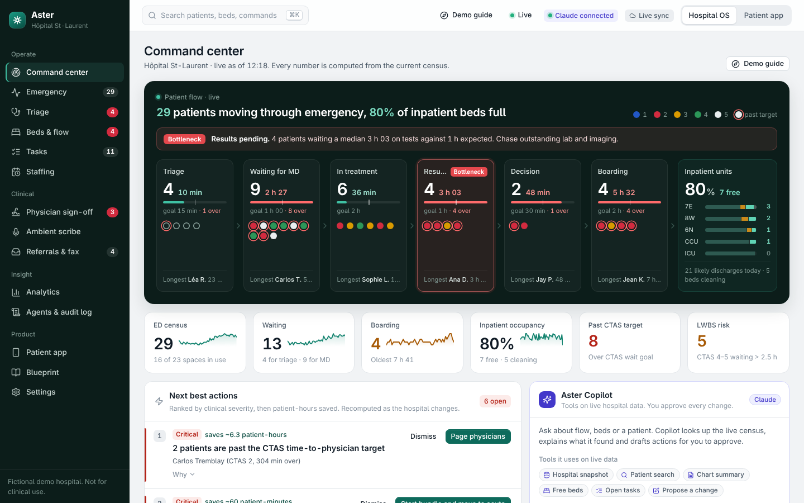
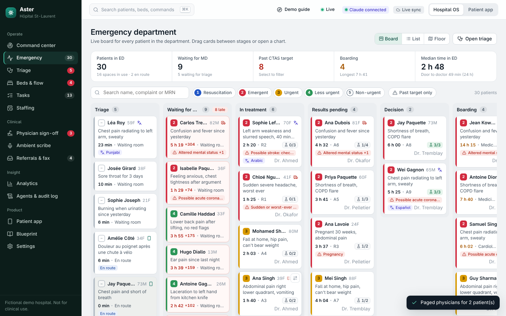
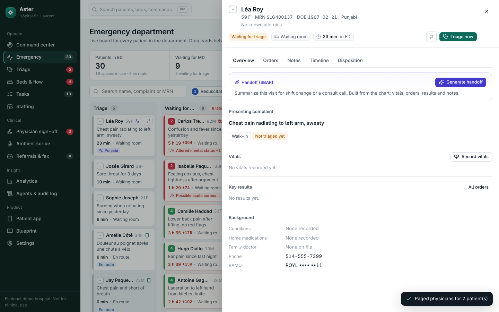
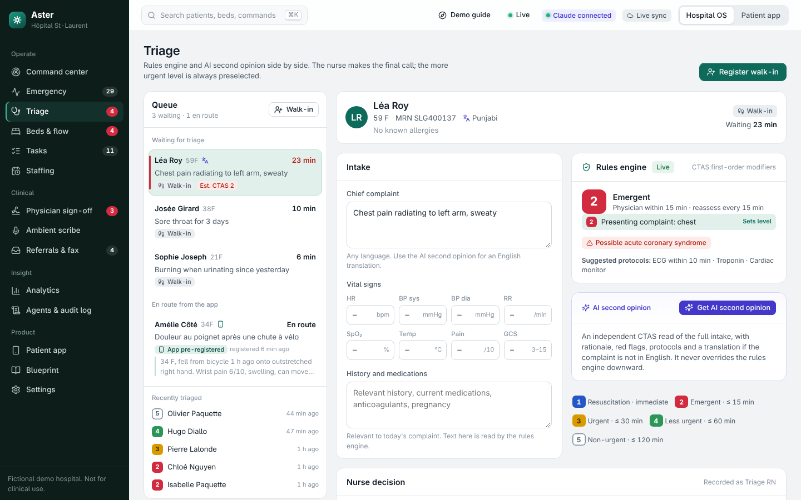
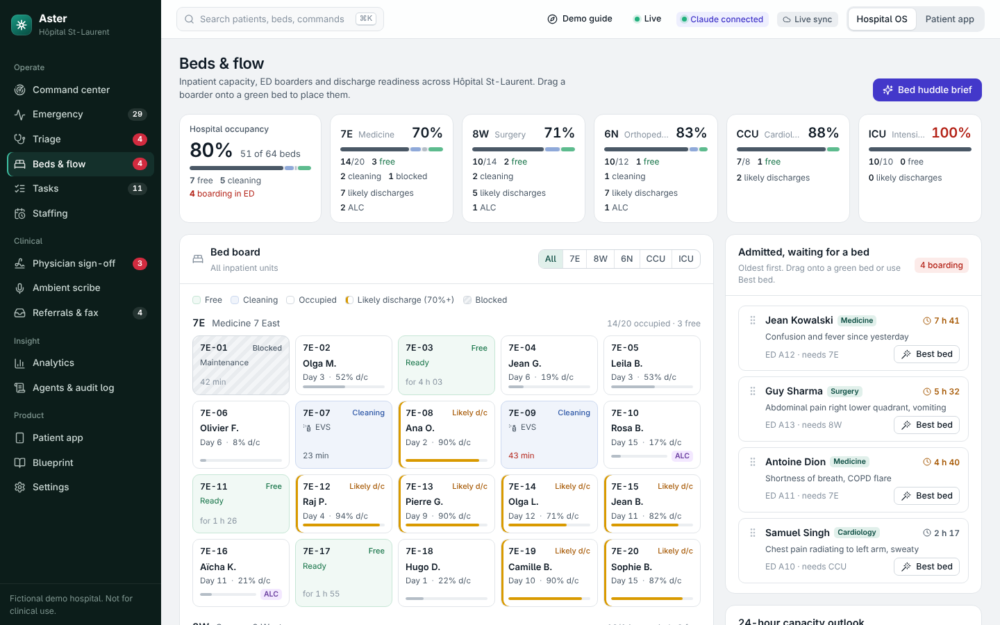
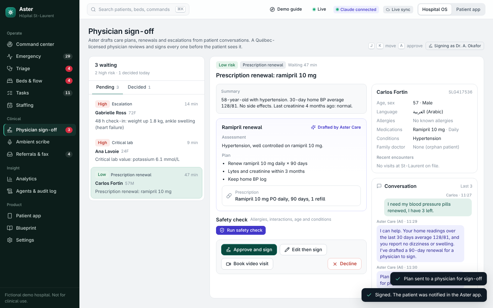
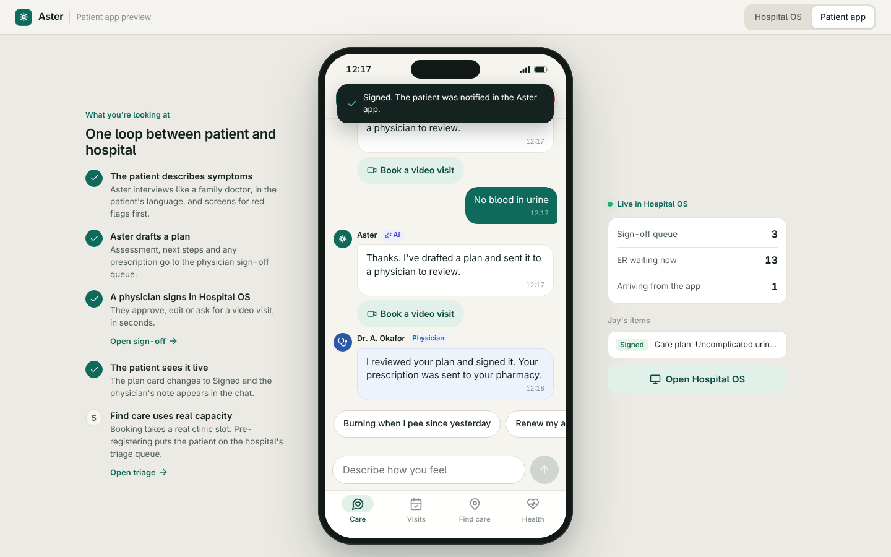
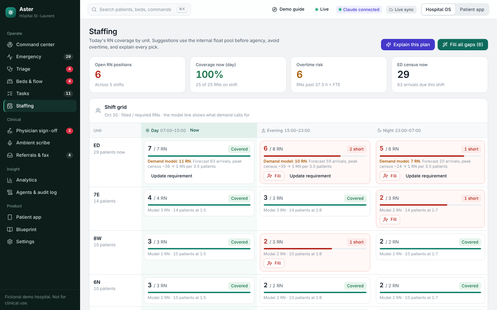
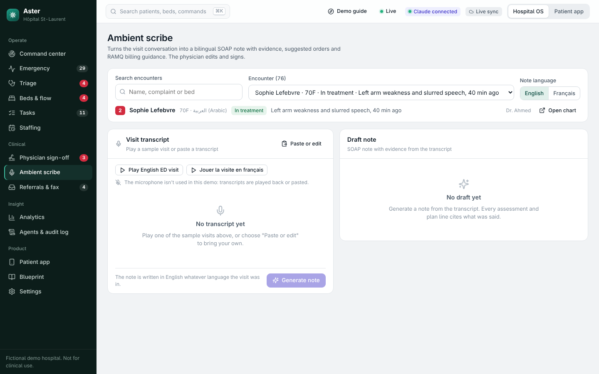
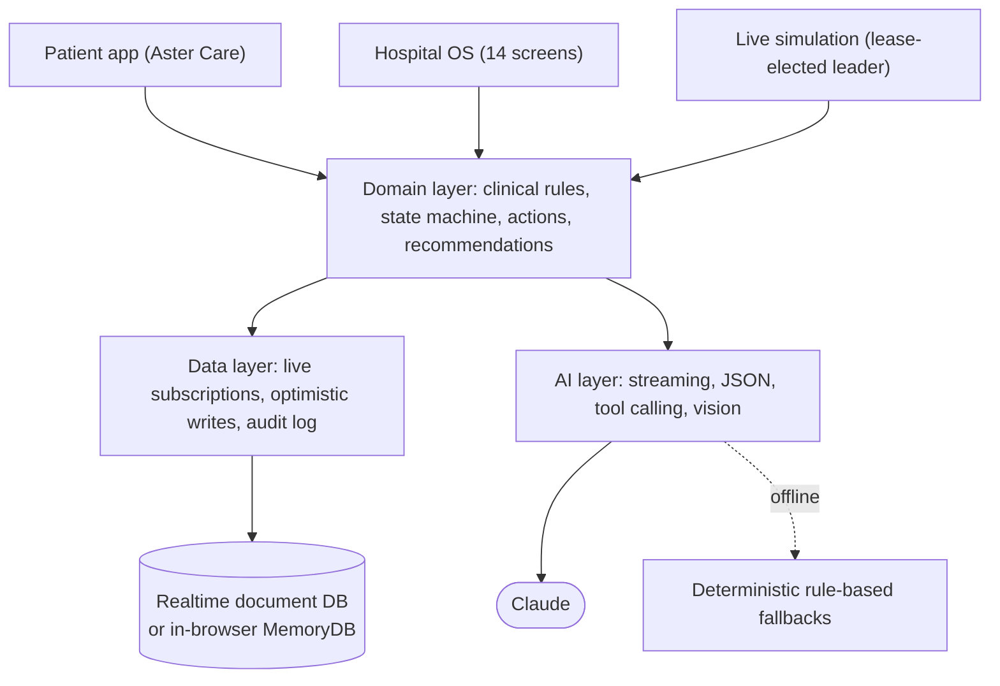

# Aster

**An AI operating system for Canadian hospitals, and an AI doctor for their patients.**

Aster is a working prototype that connects the two ends of the emergency-room problem in Québec. Patients get a free AI doctor whose plans are signed by a licensed physician. Hospitals get one live operating picture: triage, patient flow, beds, staffing, documentation and AI agents, all on a single realtime data layer.

**[Live demo](https://jashanbirx.github.io/aster/)** · runs entirely in your browser with a fictional hospital (about 100 patients, 95 beds). Use the *Demo guide* button at the top for a 3-minute walkthrough.



> Fictional demo data. Not a medical device and not for clinical use.

---

## Why

- Québec's median emergency-room stay was **5 h 12 min** in 2025, and roughly **430,000** Quebecers left an ER without being treated in a year, mostly low-acuity (P4/P5) patients.
- Across Canada, **1 in 10** admitted patients waited more than 48 hours in the ER for an inpatient bed (CIHI, 2024–25).
- About **1.2 million** Quebecers have no family doctor, so the ER becomes their front door.

The crowding is a system problem: patients with nowhere else to go come in at the front, while admitted patients can't leave at the back. Aster works on both ends at once.

## What it does

### Hospital OS (for staff)

| Module | What it does |
|---|---|
| **Command center** | Live patient-flow map across every stage, automatic bottleneck detection, KPIs with 24 h trends, ranked "next best actions" you can run in one click, and **Aster Copilot**, an LLM agent that queries live data through tools and proposes actions for human approval. |
| **Emergency board** | Kanban of every ED patient by stage with drag-and-drop, list and floor views, filters, and live wait times against CTAS targets. |
| **Patient chart** | AI handoff summary (SBAR), vitals, orders and results, notes, timeline, and disposition: discharge with AI-drafted instructions in the patient's language, admit, redirect to a same-day clinic, or left without being seen. |
| **Triage** | A deterministic CTAS rules engine (complaint plus vital-sign modifiers and a sepsis screen) re-scores on every keystroke, next to an independent AI second opinion. The more urgent level is preselected for safety. |
| **Beds & flow** | Unit occupancy, bed board, drag a boarding patient onto a free bed, discharge predictions with barriers turned into owned tasks, and a 24 h capacity outlook. |
| **Tasks** | One work queue for every role (RN, MD, cleaning, porters, pharmacy…), filled by people, the system and AI agents. |
| **Staffing** | Shift coverage versus a demand model, ranked candidates with reasons (skills, overtime, fatigue, cost), and gap filling that uses internal staff before agency. |
| **Physician sign-off** | Every AI-drafted patient plan waits here. Doctors see the conversation, history and an allergy/interaction safety check, then approve, edit, book a video visit or decline. |
| **Ambient scribe** | Turns a visit transcript (English or Québec French) into a SOAP note where each conclusion quotes the transcript, plus suggested orders. |
| **Referrals & fax** | Extracts structured data from pasted or photographed referral faxes, then creates the patient and books the slot. |
| **Analytics** | Door-to-physician time by CTAS level against targets, length of stay, arrivals by hour, outcomes, and an estimated "impact of Aster". |
| **Agents & audit log** | Eight agents with adjustable autonomy (suggest, act with approval, autonomous), and a log of every action by every person and agent. |

### Aster Care (for patients)

- **AI doctor chat** in the patient's language: one question at a time, uses their allergies and medications, screens red flags (chest pain goes straight to a "call 911" card).
- **Physician-in-the-loop:** every plan becomes a sign-off request in the Hospital OS, and the patient sees "Signed by Dr. …" update live.
- **Find care:** real same-day clinic slots, live ER load with an estimated wait, and ER pre-registration that drops the patient into the triage queue.
- **Visits:** live place in line during an ER visit, discharge instructions afterwards, and a 48 h check-in that alerts a physician if the patient is getting worse.

## Screenshots

| | |
|---|---|
|  |  |
|  |  |
|  |  |
|  |  |

## Architecture



- **Data layer (`src/lib/store.js`)**: one live subscription per collection, optimistic updates, a write queue per document, retry on transient errors, and an audit row for every change. It runs on the claude.ai artifact database (Firestore-style API) when hosted there, and otherwise on `MemoryDB` (`src/lib/memdb.js`), an in-browser implementation of the same interface persisted to `localStorage`. That is what the GitHub Pages demo uses.
- **Domain layer (`src/lib/domain.js`)**: every mutation in the app goes through one function here, so a click and an AI action behave identically and are both audited. It includes the CTAS engine, the patient state machine (arriving → triage → waiting for MD → treatment → results → decision → boarding → inpatient, or discharged / redirected / left without being seen), the recommendation engine, metrics, and the staffing model.
- **AI layer (`src/lib/ai.js`)**: streaming text, structured JSON with a self-repair retry, a tool-calling agent loop, and vision. Every call returns `null` when AI is unavailable, and every feature has a deterministic fallback.
- **Simulation (`src/lib/sim.js`)**: keeps the demo hospital alive (arrivals, results, cleaning). Only one open device drives it, chosen through a short database lease.
- **Seed (`src/lib/seed.js`, `src/lib/boot.js`)**: generates a consistent fictional hospital with a seeded PRNG, and shifts all timestamps forward when the demo has been idle so wait times stay realistic.

More detail, including the full data model, is in [ARCHITECTURE.md](ARCHITECTURE.md).

### Design decisions

- **Rules and AI side by side, never AI alone.** Triage shows the deterministic CTAS result and the AI opinion together and preselects the more urgent one. Allergy and interaction checks run as rules before any AI check.
- **Humans approve clinical changes.** The copilot can only *propose* actions; each proposal is validated against live data twice (when proposed and when approved). Patient plans always need a physician signature.
- **Works offline.** With no AI and no cloud database, the whole product still runs on rules and the in-browser database, which is how the public demo works.
- **One source of truth.** Both apps share the same records, so the loops are real: chat → plan → physician signs → patient sees it live; pre-registration → triage queue; discharge → check-in → escalation.

## Tech stack

- **Frontend:** React 19 (hooks, `useSyncExternalStore`, portals), JavaScript (ES2020+, JSX), a custom CSS design system (tokens, grid/flex, responsive to 390 px, reduced-motion support), HTML5 drag and drop, hand-built SVG charts, Lucide icons via `react-icons`.
- **Data:** realtime document database with live queries; custom `MemoryDB`; optimistic updates; per-document write queues; lease-based leader election.
- **AI:** Claude via the claude.ai artifact runtime: streaming, structured output, tool calling (6 tools), vision.
- **Build and test:** esbuild, Playwright end-to-end tests against a fake runtime that simulates database latency and LLM tool calls.

## Run it locally

Requires Node.js 18+.

```bash
git clone https://github.com/Jashanbirx/aster.git
cd aster
npm install
npm start          # builds to dist/ and serves http://localhost:8000
```

Locally the app uses the in-browser database and rule-based AI fallbacks. Data persists in your browser; use **Settings → Reset demo hospital** to start over.

### Tests

```bash
npx playwright install chromium   # first time only
npm start                         # in one terminal
npm run test:routes               # every screen, desktop + mobile, local and simulated-cloud modes
npm run test:e2e                  # patient chat → plan → physician sign-off → patient sees it
```

## Project structure

```
src/
  lib/        store.js · memdb.js · domain.js · ai.js · seed.js · boot.js · sim.js · ui-state.js
  ui/         design-system components (index.jsx) and clinical components (clinical.jsx)
  os/         Hospital OS screens: command, ed, chart, triage, beds, tasks, staffing,
              signoff, scribe, referrals, analytics, audit, blueprint (market research)
  patient/    Aster Care patient app
  app.jsx     shell, navigation, command palette (Ctrl/Cmd+K), settings
scripts/      build, static server
test/         Playwright tests and the fake claude.ai runtime
docs/         GitHub Pages build and screenshots
```

## Status

A prototype built in October 2026 to explore an AI-native hospital operating system for Québec. The hospital, patients and staff are fictional; integrations with EHRs, SMS, pharmacies and fax are simulated. Built with AI-assisted development: the architecture, data model and engineering contract were defined up front ([ARCHITECTURE.md](ARCHITECTURE.md)) and modules were implemented in parallel by AI coding agents, then integrated and tested end to end.

**Author:** Jashanbir Singh, Computer Science and Mathematics, McGill University.
